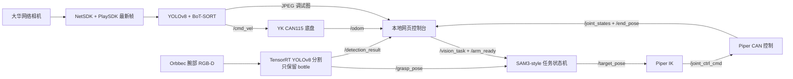

# 人员跟随小车 + Piper 抓取整合项目指南

## 1. 项目结果

目标工作区：`/home/zheng/person_follow_ws`。

本项目在 ROS 2 Humble / Ubuntu 22.04 下整合了两套原有系统。`跟随启动.doc` 仅作为旧启动步骤的参考，文档中的路径和命令没有被当作自动执行指令；其中仍有效的大华相机 Windows 转发步骤已纳入本指南。

当前功能如下：

- “数智巡检平台”网页一键启动、停止人员跟随；停止时连续发布零速度。
- 网页显示大华相机人员检测/跟踪结果、`/cmd_vel`、航向以及“前进/后退/左转/右转”状态。
- 网页一键启动 Piper 系统，任务节点启动后自动移动到准备姿态。
- 网页显示 Orbbec 腕部相机的分割结果、实时关节角、末端 XYZ，以及与 RViz 共用 `piper_description.urdf` 和 STL mesh 的机械臂三维模型。
- 点击“抓取 bottle”后执行：张爪 → 预抓取 → 抓取 → 闭爪 → 撤退 → 指定放置点 → 松爪 → 返回准备姿态。
- 机械臂识别白名单只有 `bottle`。
- 只保留当前 SAM3-style 抓取方案，原 `legacy_direct` 第二方案及其偏移、模式变量和备份代码已从目标项目清除。
- 抓取安全联锁：若网页启动的人员跟随仍在运行，抓取按钮会先停底盘并等待跟随进程退出，再自动开始抓取；若检测到网页之外的节点仍在发送非零速度，则拒绝抓取。



## 2. 目录说明

```text
person_follow_ws/
├── src/
│   ├── person_follower/          大华取流、人员跟踪和速度计算
│   ├── vehicle_bringup/          底盘 ROS 2 节点
│   ├── yk_can_sdk/               CAN115 TCP 协议
│   ├── robot_dashboard/          网页、HTTP/ROS 桥和进程管理
│   ├── graspgen_bringup/         机械臂整套 launch 与手眼外参
│   ├── graspgen_perception/      TensorRT bottle 分割与抓取点
│   ├── graspgen_tasks/           唯一保留的 SAM3-style 抓取任务
│   ├── piper/                    Piper 控制节点
│   ├── piper_description/        URDF、网格和 RViz 配置
│   ├── piper_kinematics_ros2/    逆运动学
│   ├── piper_msgs/               Piper 消息
│   └── OrbbecSDK_ROS2/           腕部 RGB-D 相机驱动
├── scripts/
│   ├── start_dashboard.sh        启动网页控制台
│   ├── start_follow.sh           单独启动人员跟随
│   ├── can_activate.sh           配置 Piper SocketCAN
│   ├── stop_robot.sh             连续发布底盘零速
│   ├── netsdk_env.sh             大华原生库环境
│   └── start_camera_relay_windows.ps1
└── docs/
```

## 3. 已验证的环境

本次在本机 WSL Ubuntu 22.04 中确认：

- ROS 2 Humble。
- NVIDIA GeForce RTX 3050 Laptop GPU，可被 WSL 识别。
- CUDA 11.8：`/usr/local/cuda-11.8/bin/nvcc`。
- TensorRT 8.6.1.6：`/usr/local/TensorRT-8.6.1.6`。
- `piper-sdk` 0.6.1（依赖 `python-can`）。
- 大华 Linux NetSDK + PlaySDK 已由项目 `vendor` wheel 安装。
- 15 个 ROS 2 包完整 Release 构建通过；网页与控制器共 10 项无硬件测试通过。

TensorRT/CUDA 不由通用依赖脚本自动安装，因为版本必须与显卡驱动、现有 `.engine` 模型一致。当前 CMake 会在非交互 shell 中自动查找 `/usr/local/cuda/bin/nvcc` 和 `/usr/local/cuda-11.8/bin/nvcc`。

## 4. 首次安装依赖

```bash
cd ~/person_follow_ws
chmod +x scripts/*.sh
./scripts/install_dependencies.sh
```

脚本安装 ROS 消息、TF、CV Bridge、image transport、PCL、robot_state_publisher、RViz2；Orbbec 的 camera/diagnostics/gflags/glog/libusb；机械臂的 CAN、SciPy、`piper_sdk`；人员识别所需 OpenCV、PyTorch、Ultralytics；以及项目内大华 Linux NetSDK wheel。

检查关键依赖：

```bash
source /opt/ros/humble/setup.bash
python3 -c "import piper_sdk, cv2, numpy, scipy; print('Python dependencies OK')"
python3 -c "from NetSDK.NetSDK import NetClient; print('NetSDK import OK')"
/usr/local/cuda-11.8/bin/nvcc --version
ls /usr/local/TensorRT-8.6.1.6/lib/libnvinfer.so
```

### 4.1 Orbbec USB 权限

首次使用 Orbbec 时安装项目自带 udev 规则：

```bash
cd ~/person_follow_ws/src/OrbbecSDK_ROS2/orbbec_camera/scripts
sudo bash install_udev_rules.sh
sudo udevadm control --reload-rules
sudo udevadm trigger
```

重新插拔相机后检查：

```bash
lsusb | grep -i 2bc5
```

如果 `lsusb` 看不到设备，问题在 Windows 到 WSL 的 USB 连接层，ROS 节点也不会看到相机。先把 Orbbec USB 设备附加给 Ubuntu-22.04，再继续调试。

## 5. 构建

```bash
cd ~/person_follow_ws
source /opt/ros/humble/setup.bash
colcon build --symlink-install --cmake-args -DCMAKE_BUILD_TYPE=Release
source install/setup.bash
```

正常结果应为 `Summary: 15 packages finished`。TensorRT 8.6 的 deprecated 警告和 Piper `tests_require` 警告不影响构建；出现 `Failed` 才是失败。

修改 Python、YAML 或网页后：

```bash
colcon build --symlink-install --packages-select \
  robot_dashboard person_follower graspgen_tasks
source install/setup.bash
```

修改 CUDA/C++ 感知代码后：

```bash
colcon build --symlink-install --packages-select graspgen_perception \
  --cmake-clean-cache --cmake-args -DCMAKE_BUILD_TYPE=Release
source install/setup.bash
```

## 6. 每次开机的完整启动流程

### 6.1 安全准备

1. 清空小车四周和机械臂运动半径，确认机械臂底座固定。
2. 急停应在操作者触手可及处。
3. 首次验证架空车轮；夹爪中不要放易碎、尖锐或重物。
4. 抓取时底盘必须停止。网页有联锁，但外部 ROS 节点也必须关闭。
5. 确认 CAN115 底盘端口 `192.168.0.7:5578` 没有被其他程序占用。

### 6.2 Windows：启动大华相机转发

WSL 不能直连 `192.168.1.21:37777` 时，在 Windows PowerShell 运行：

```powershell
cd \\wsl.localhost\Ubuntu-22.04\home\zheng\person_follow_ws
PowerShell -ExecutionPolicy Bypass -File scripts\start_camera_relay_windows.ps1
```

该窗口需要保持运行。它把 Windows 的大华相机连接转发到供 WSL 使用的 `37778` 端口；`start_follow.sh` 会优先直连相机，失败后自动探测此转发。

### 6.3 WSL：Piper CAN 自动配置

底盘的 `192.168.0.7:5578` 是网络 CAN115；Piper 使用 Linux SocketCAN，两者不是同一个接口。

`start_dashboard.sh` 已包含 Piper CAN 检查：检测到 `can0` 后自动调用 `can_activate.sh can0 1000000`，不再需要每次手动执行。接口尚未连接时，脚本会给出提示但仍允许只使用小车跟随；这种情况下连接 USB-CAN 后需要重新启动控制台脚本。

首次配置可能在当前终端请求一次 `sudo` 密码。已经处于 `UP` 且为 1 Mbps 时不会重复调用 sudo。需要使用其他接口时：

```bash
PIPER_CAN_PORT=can1 ./scripts/start_dashboard.sh
```

调试时仍可手动检查：

```bash
ip -details link show can0
```

### 6.4 WSL：启动网页控制台

```bash
cd ~/person_follow_ws
./scripts/start_dashboard.sh
```

看到 `控制台已启动：http://127.0.0.1:8080` 后，在 Windows 或 WSL 浏览器打开：

```text
http://127.0.0.1:8080
```

网页默认只监听回环地址，不对局域网开放。打开网页不会自动移动任何设备。

## 7. 网页按钮与使用顺序

### 7.1 人员跟随

- `启动跟随`：调用 `scripts/start_follow.sh show_window:=false`，启动底盘和大华人员跟随节点。
- `停止并置零`：连续发布三次 `/cmd_vel=0`，再向网页管理的跟随进程发送 SIGINT；8 秒未退出时升级为 SIGTERM。
- 画面叠加目标 ID、线速度、角速度、推理时间与帧龄。
- 右侧显示网页实际监听到的 `/cmd_vel` 和 `/odom` 航向，不是前端估算值；里程计 X/Y 不在网页展示。

| 速度条件 | 网页显示 |
|---|---|
| 线速度和角速度接近 0 | 停止 |
| `linear.x > 0` | 前进 |
| `linear.x < 0` | 后退 |
| `angular.z > 0` | 左转 |
| `angular.z < 0` | 右转 |
| 两者同时存在 | 前进并左转、前进并右转等 |

### 7.2 机械臂

建议顺序：

1. 点击 `启动机械臂`。
2. 观察日志、腕部相机画面和关节反馈。任务节点启动后会自动发准备姿态。
3. 如需再次回到准备姿态，确保当前没有抓取任务和夹持物，再点击 `到准备姿态`。
4. 将一个 bottle 放在已标定且可达的腕部相机视野/工作区内。
5. 确认画面持续识别 bottle，点击 `抓取 bottle` 并确认安全提示。
6. 观察预抓取、抓取、撤退、放置、松爪和返回准备姿态。

按钮含义：

- `启动机械臂`：启动 Orbbec、TF/Piper、TensorRT 感知、IK 和抓取任务；网页模式不启动原生 RViz。
- `机械臂实时模型`：网页从本机加载 `piper_description/urdf/piper_description.urdf` 及其 `meshes/*.STL`，与 RViz 使用相同模型文件；`/joint_states` 经独立 SSE 通道以最高 30 Hz 推送，浏览器按 60 FPS 对 6 轴与夹爪做平滑插值。鼠标左键拖动旋转视角，滚轮缩放。Three.js、STLLoader 和 OrbitControls 已打包在项目内，运行时不联网，也不需要 Node.js/npm。
- `到准备姿态`：发布 `/arm_ready=true`。任务忙或夹爪正在持物时会被拒绝。
- `抓取 bottle`：发布 `/vision_task=1`。重复点击会由任务节点拒绝。
- `取消抓取`：发布 `/vision_task=0`。如果已经夹住物体，任务保持闭爪，避免取消时掉落。
- `停止机械臂节点`：先取消当前任务，命令六个关节回到 `[0,0,0,0,0,0]`；收到实际关节反馈确认后才停止整套机械臂进程。15 秒未收到零点确认时节点保持运行并显示错误，避免在未回零时误判停机。若正在夹持物体则保持闭爪，只回六轴零点。

姿态画布使用实时 `/joint_states` 绘制轻量机械臂示意，并列出各关节角度；它用于监控变化，不替代 MoveIt/RViz 碰撞检查。末端位置来自 `/end_pose`。

## 8. 关键 ROS 2 话题

| 话题 | 类型 | 生产/用途 |
|---|---|---|
| `/cmd_vel` | `geometry_msgs/Twist` | 人员跟随速度、网页停止置零 |
| `/odom` | `nav_msgs/Odometry` | 底盘累计位置与航向 |
| `/person_follower/debug/compressed` | `sensor_msgs/CompressedImage` | 大华识别叠加画面 |
| `/camera/color/image_raw` | `sensor_msgs/Image` | Orbbec 彩色图 |
| `/camera/depth/image_raw` | `sensor_msgs/Image` | 对齐深度图 |
| `/detection_result` | `sensor_msgs/Image` | bottle 分割结果 |
| `/grasp_pose` | `geometry_msgs/PoseStamped` | 视觉生成的抓取目标 |
| `/target_pose` | `geometry_msgs/PoseStamped` | 任务节点发给 IK 的目标 |
| `/ik_status` | `std_msgs/Bool` | IK 成功/失败反馈 |
| `/joint_ctrl_cmd` | `sensor_msgs/JointState` | Piper 关节控制命令 |
| `/joint_states` | `sensor_msgs/JointState` | 实际关节反馈与网页姿态 |
| `/end_pose` | `geometry_msgs/Pose` | 实际末端姿态 |
| `/vision_task` | `std_msgs/Int32` | `1` 抓取、`0` 取消 |
| `/arm_ready` | `std_msgs/Bool` | 返回准备姿态 |
| `/arm_shutdown` | `std_msgs/Bool` | 请求回零后停止 |
| `/arm_shutdown_ready` | `std_msgs/Bool` | 实际零点到达确认 |
| `/grasp_status` | `std_msgs/String` | 网页任务文字 |
| `/vision_result` | `std_msgs/Int32` | `2` 执行中、`1` 成功、`-1` 失败 |

## 9. 分层调试（不要直接从整机动作开始）

每个 WSL 终端先执行：

```bash
cd ~/person_follow_ws
source /opt/ros/humble/setup.bash
source install/setup.bash
```

### 9.1 网页本身

```bash
./scripts/start_dashboard.sh
curl http://127.0.0.1:8080/api/status
```

JSON 中 `follow.running` 和 `arm.running` 初始都应为 `false`。网页静态文件、URDF/STL 资源和 API 由同一个节点提供，运行时不需要 Flask、Node.js 或 npm。

```bash
ss -ltnp | grep 8080
./scripts/start_dashboard.sh -p port:=8081
```

第二条命令可在 8080 被占用时临时改端口。

### 9.2 底盘（先架空车轮）

完整步骤见 `docs/小车运动控制调试指南.md`。最低限度检查：

```bash
ping -c 3 192.168.0.7
timeout 3 bash -c '</dev/tcp/192.168.0.7/5578' && echo CAN115_OK
ros2 launch vehicle_bringup chassis.launch.py
```

另一终端以很小速度短脉冲测试，随后立即置零：

```bash
ros2 topic pub --once /cmd_vel geometry_msgs/msg/Twist \
  "{linear: {x: 0.05}, angular: {z: 0.0}}"
sleep 0.3
./scripts/stop_robot.sh
```

方向不正确时先修底盘映射/标定，不要靠修改人员识别框补偿。

### 9.3 大华相机与人员跟随（不启动底盘）

```bash
./scripts/start_follow.sh start_chassis:=false show_window:=false
```

另一终端：

```bash
ros2 topic hz /person_follower/debug/compressed
ros2 topic echo /cmd_vel
```

此时只计算速度，不发送到实际底盘节点。日志应稳定报告 FPS、推理时间和当前帧龄；若帧超时，节点会主动发布零速。

### 9.4 Orbbec 相机

```bash
ros2 launch graspgen_bringup dabai_dcl_grasp.launch.py
```

另一终端：

```bash
ros2 topic hz /camera/color/image_raw
ros2 topic hz /camera/depth/image_raw
ros2 topic echo --once /camera/color/camera_info
```

当前配置保留源项目工作参数：彩色 640×480 MJPG 15 FPS、深度 640×400 15 FPS、软件 D2C 对齐。

### 9.5 感知与 TF（机械臂保持不动）

保持 Orbbec 运行，再启动：

```bash
ros2 launch graspgen_perception yolov8.launch.py
```

检查：

```bash
ros2 topic hz /detection_result
ros2 topic echo /grasp_pose
ros2 run tf2_ros tf2_echo base_link camera_color_optical_frame
```

把 bottle 放入视野后才应出现有效 `/grasp_pose`。其他 COCO 类别即使在标签文件中存在，也会被 `target_classes: [bottle]` 白名单过滤，不允许进入抓取点逻辑。

### 9.6 Piper CAN 与反馈（不发动作）

```bash
./scripts/can_activate.sh can0 1000000
candump can0
```

确认总线有数据后，另一个终端启动控制与 RViz，但关闭自动使能：

```bash
ros2 launch piper start_single_piper_rviz.launch.py \
  can_port:=can0 auto_enable:=false start_rviz:=true
```

```bash
ros2 topic hz /joint_states
ros2 topic echo /arm_status
ros2 topic echo /end_pose
```

### 9.7 机械臂整套启动

```bash
ros2 launch graspgen_bringup system.launch.py start_rviz:=true
```

它会先检查 `can0` 是否存在、UP 且为 1 Mbps；失败时不会继续启用机械臂。任务节点会移动到准备姿态，因此执行前必须按实机动作对待。

命令行触发仅用于网页故障排查：

```bash
ros2 topic pub --once /arm_ready std_msgs/msg/Bool "{data: true}"
ros2 topic pub --once /vision_task std_msgs/msg/Int32 "{data: 1}"
ros2 topic pub --once /vision_task std_msgs/msg/Int32 "{data: 0}"
```

不要在外部跟随节点运行时发送抓取命令；命令行不会经过网页安全联锁。

## 10. 抓取参数

当前唯一抓取参数文件：`src/graspgen_tasks/config/task.yaml`。

- `sam3_penetration`：工具相对目标的插入深度。
- `sam3_pull_back`：法兰回拉量。
- `sam3_lateral_offset`：横向补偿。
- `sam3_pregrasp_distance`：预抓取距离。
- `sam3_retreat_extra_z`：抓取后的额外抬升。
- `place_position`：放置点 `[x, y, z]`，坐标系为 `base_link`。
- `home_joint_positions`：准备姿态 6 关节和夹爪目标。
- `orientation_retry_*`：IK 姿态重试范围和步长。

识别白名单在 `src/graspgen_perception/config/perception.yaml` 中固定为 `target_classes: [bottle]`。

手眼外参位于 `src/graspgen_bringup/config/camera_extrinsics.yaml`。当前 `link6 -> camera_link` 标定平移为 `[-0.08094894, 0.00423940, 0.04114984] m`。机械臂、腕部相机安装位置发生变化后必须重新标定，不能仅调抓取偏移掩盖外参错误。

## 11. 常见故障

### 网页能开，但画面是空白

- 人员画面：检查跟随进程日志、Windows 相机转发和 `/person_follower/debug/compressed`。
- 机械臂画面：检查 Orbbec USB、`/detection_result` 和 TensorRT 感知进程。
- 网页中的“无画面/几秒前”是最后一帧年龄，可用来区分完全无数据和视频卡住。

机械臂感知节点的 `/detection_result` 使用 Best Effort SensorDataQoS；网页订阅端已同步使用 SensorDataQoS。旧版本出现 `incompatible QoS ... RELIABILITY` 时会完全收不到腕部图像，重新构建并重启网页节点后该警告应消失。

### 大华画面延迟十几秒

当前跟随节点使用 NetSDK 实时码流回调 + PlaySDK 解码，只保留最新帧，不使用 OpenCV/FFmpeg RTSP 缓冲方案。确认实际启动的是 `start_follow.sh`/网页管理的 `person_follower`，而不是旧 OpenCV 取流脚本。日志中的 `frame_age` 应是毫秒级而不是十几秒。

### 机械臂实时模型为空或提示加载失败

网页模型不是线段示意，而是直接加载 Piper URDF 与 STL。先检查资源接口：

```bash
curl -I http://127.0.0.1:8080/model/piper_description.urdf
curl -I http://127.0.0.1:8080/model/meshes/base_link.STL
curl -I http://127.0.0.1:8080/urdf_viewer.bundle.js
```

三项都应返回 `200 OK`。如果刚更新过项目，必须安全停止机械臂、退出旧控制台并重新运行 `./scripts/start_dashboard.sh`，然后在浏览器按 `Ctrl+F5`。模型有外观但不随动时检查：

```bash
ros2 topic info -v /joint_states
ros2 topic hz /joint_states
```

网页平滑关节流可用下面的命令检查；持续出现 `data:` 行表示 30 Hz 数据链路正常：

```bash
curl -N http://127.0.0.1:8080/stream/joints.sse
```

### `CAN interface 'can0' was not found`

```bash
ip link show type can
./scripts/can_activate.sh can0 1000000
```

若没有任何 CAN 接口，先处理 USB-CAN 到 WSL 的设备连接；`skip_can_check:=true` 只可用于无硬件解析 launch，不得用于实机动作。

### `No CMAKE_CUDA_COMPILER could be found`

```bash
ls -l /usr/local/cuda-11.8/bin/nvcc
colcon build --packages-select graspgen_perception --cmake-clean-cache
```

若 CUDA 在其他目录：

```bash
colcon build --packages-select graspgen_perception \
  --cmake-args -DCMAKE_CUDA_COMPILER=/实际路径/nvcc
```

### TensorRT engine 加载失败

当前 engine 位于 `graspgen_perception/config/yolov8n-seg.engine`。TensorRT engine 通常与 GPU 架构和 TensorRT 版本绑定；更换 GPU、CUDA 或 TensorRT 后应按源模型重新生成 engine，不能仅复制旧 engine。

### `No fresh grasp pose; task rejected`

抓取按钮只接受 0.5 秒内更新的 `/grasp_pose`：

```bash
ros2 topic hz /grasp_pose
ros2 topic hz /camera/depth/image_raw
ros2 topic echo /grasp_status
```

确保 bottle 掩膜置信度、有效深度点数和最大深度均满足 `perception.yaml`。

### `IK failed for all orientation candidates`

目标可能超出 Piper 可达范围、外参错误或目标姿态不可达。先核对 `/grasp_pose` 坐标、TF 和实物测量，不要第一时间放大 IK 重试范围。将 bottle 移到标定中心区域做最小风险验证。

### 取消后夹爪没有松开

这是故意的安全行为：在已经闭爪持物后取消，默认保持闭爪，防止物体掉落。确认下方安全后手动松爪：

```bash
ros2 topic pub --once /gripper_cmd std_msgs/msg/Float64 "{data: 0.07}"
```

## 12. 测试与验收清单

软件回归：

```bash
cd ~/person_follow_ws
source /opt/ros/humble/setup.bash
source install/setup.bash
python3 -m pytest -q src/robot_dashboard/test src/person_follower/test
ros2 launch graspgen_bringup system.launch.py --show-args
ros2 launch person_follower follow.launch.py --show-args
```

本次结果：`8 passed`；完整构建 `15 packages finished`。

实机验收按顺序打勾：

- [ ] 急停与人工断能可用。
- [ ] 架空测试底盘前进、后退、左右转方向正确。
- [ ] 大华人员画面实时，停止跟随后 `/cmd_vel` 为零。
- [ ] Orbbec 彩色/深度 15 FPS 左右，TF 连通。
- [ ] 非 bottle 不产生可执行抓取目标。
- [ ] Piper 反馈正常，准备姿态方向和限位正确。
- [ ] 抓取时底盘安全联锁生效。
- [ ] bottle 在低风险位置完成抓取、放置、松爪、回准备姿态。
- [ ] 拔掉/遮挡任一相机、断开 CAN、丢失目标时系统进入预期安全状态。

## 13. 停机

优先使用网页：

1. `取消抓取`（夹持物时先安全放置或人工处理）。
2. `停止并置零`。
3. `停止机械臂节点`，等待页面显示机械臂已回零、节点停止中。
4. 在运行 `start_dashboard.sh` 的终端按 `Ctrl+C`。

网页进程退出时也会尝试发布底盘零速、发布抓取取消并停止它管理的子进程。网页不能代替物理急停；出现异常运动时立即使用实物急停/断能。
